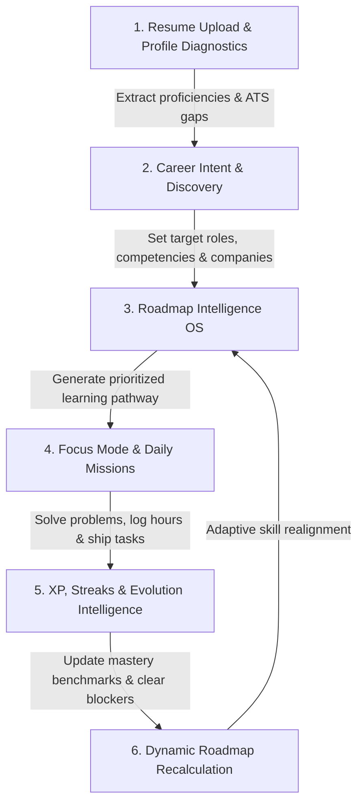

# DevTrack: Developer Productivity & Career Readiness OS

> **Status:** **Beta Candidate** — Core platform domains are structurally complete, build-green, and actively validated.

[](https://www.typescriptlang.org/)
[](https://react.dev/)
[](https://expressjs.com/)
[](https://www.mongodb.com/)
[](https://redis.io/)
[](https://github.com/VarshithReddy2006/DevTrack/actions)
[](https://opensource.org/licenses/MIT)

DevTrack is a developer productivity, telemetry, and career readiness platform built as a TypeScript monorepo. It connects competitive programming activity (LeetCode, Codeforces, CodeChef) and GitHub contributions with project management, ATS resume intelligence, personalized learning roadmaps, and gamification.

The platform continuously closes the loop between **where a developer spends their time** and **what competencies they need next** to reach their target engineering roles.

---

## 🎯 What DevTrack Does

| Core Area | Capabilities |
|---|---|
| **DSA Intelligence & Tracking** | Problem indexing, platform scraping, daily challenges, topic-level mastery heatmaps, contest trackers, and weekly analytics. |
| **Platform Synchronization** | Scheduled ingestion from GitHub, Codeforces, LeetCode (public endpoints), and CodeChef. |
| **Project Workspace** | Full-stack project and task management, velocity metrics, status Kanban, and GitHub repository linkages. |
| **Focus Mode & Mission Control** | Daily missions, persistent Pomodoro/stopwatch timers, active checklist cards, and automatic streak upkeep. |
| **Resume Intelligence OS** | PDF/DOCX multi-format parsing, ATS compatibility audits, GitHub claim verification, variant drafting, and exportable report dossiers. |
| **Career Readiness Engine** | Diagnostic benchmarks, role gap analysis, adaptive roadmap sequencing, evolution progression graphs, and AI guidance. |
| **Gamification Engine** | XP accrual, level curves (1–10+), consecutive day streaks with freeze mechanics, milestone awards, and badges. |
| **Real-time WebChannels** | Server-Sent Events (SSE) singleton channels backed by Redis pub/sub for real-time dashboard updates and live toasts. |
| **Operations & Observability** | Queue monitoring, BullMQ Dead Letter Queue (DLQ) inspection and replay, health checks, and beta metrics. |

---

## 🔄 The Growth Loop Workflow

DevTrack functions as a feedback-driven progression loop:



1. **Intake & Diagnostics:** Upload an existing CV or synchronize platforms to establish baseline proficiency.
2. **Gap Analysis:** The Readiness Engine compares verified capabilities against targeted job role requirements.
3. **Active Practice:** The developer completes daily missions in Focus Mode with integrated Pomodoro tracking.
4. **Telemetry & Rewards:** Activity fires progression sagas, awarding XP, maintaining streaks, and logging verifiable telemetry.
5. **Adaptive Realignment:** Roadmap competencies automatically adapt as milestones are reached.

---

## 💻 Tech Stack

| Domain | Technologies |
|---|---|
| **Frontend** | React 19, Vite 8, TypeScript 5.9, Tailwind CSS 4, Framer Motion 12, Zustand 5, TanStack Query 5, Axios, Clerk React |
| **Backend** | Express 5.1, TypeScript 5.9, Mongoose 8.14, BullMQ 5.76, ioredis 5.10, Zod 3.24, Helmet 8.1, Clerk Express |
| **Datastores** | MongoDB 7.0+ (Mongoose ODM), Redis 7.0+ (Caching, Pub/Sub & BullMQ Queues) |
| **AI Providers** | Google Gemini (`@google/generative-ai`), OpenAI (`openai`), PDF/DOCX parsers (`pdf-parse`, `mammoth`) |
| **Testing** | Vitest 4 (Backend Unit & Integration; Frontend Unit), Playwright 1.48 (Browser End-to-End) |
| **Deployment** | Render (Express Web Service + Background Workers), Vercel (React Frontend SPA), Docker Compose |

---

## 📁 Repository Structure

```text
DevTrack/
├── .github/                      # CI/CD Workflows
│   └── workflows/
│       ├── pr-checks.yml         # Lint, typecheck, unit tests, integration tests, Docker build
│       ├── deploy-production.yml # Automated Render deploy trigger & Vercel documentation
│       └── deploy-staging.yml    # Manual workflow_dispatch staging deployment
├── dev-orchestrator/             # Local multi-service development orchestrator
│   ├── src/
│   │   ├── console/              # Terminal formatting & status indicators
│   │   ├── monitor/              # Port availability & service health probes
│   │   ├── orchestrator/         # Child-process manager (API + Workers + Client)
│   │   └── utils/                # Runtime cache cleaners & port releasers
│   └── package.json
├── backend/                      # Express 5 REST API & BullMQ Workers
│   ├── src/
│   │   ├── config/               # Environment variable schemas & constants
│   │   ├── db/models/            # 60+ Mongoose models (Readiness, Resume, XP, Projects)
│   │   ├── middleware/           # Clerk JWT auth, rate limiting, error handlers, validation
│   │   ├── modules/              # Modular domain controllers, services, and routes
│   │   │   ├── auth/             # Clerk identity synchronization
│   │   │   ├── dsa/              # DSA problem trackers & LeetCode calendar parser
│   │   │   ├── readiness/        # Benchmark calculations, skill gap analysis, evolution
│   │   │   ├── resume/           # ATS engine, extraction mappers, wording optimizer
│   │   │   ├── streak/           # Consecutive activity streak logic & freeze system
│   │   │   └── xp/               # Gamification point rules and leveling sagas
│   │   ├── shared/               # Redis singletons, BullMQ worker factories, SSE channels
│   │   ├── index.ts              # API server entrypoint
│   │   └── worker-entrypoint.ts  # Standalone worker cluster entrypoint
│   └── package.json
├── frontend/                     # React 19 Client SPA
│   ├── src/
│   │   ├── components/           # Reusable UI components, timers, dashboards
│   │   ├── features/             # Domain components (Readiness, ResumeTracker, Focus)
│   │   ├── pages/                # Route targets (Dashboard, Focus, DSA, Projects, Readiness)
│   │   ├── services/             # Axios API clients & SSE connection listeners
│   │   ├── store/                # Zustand client stores (auth, progression, missions, ui)
│   │   └── router/               # React Router configuration
│   └── package.json
├── docs/                         # Extended project documentation
│   ├── ARCHITECTURE.md           # System topology, queue lifecycle, data flow
│   ├── DEPLOYMENT.md             # Production hosting on Render & Vercel
│   ├── CONTRIBUTING.md           # Contribution guidelines & NWoC 2026 rules
│   └── PROJECT_STATUS.md         # Factual component health & verification status
├── docker-compose.yml            # Local development infrastructure (MongoDB + Redis)
├── docker-compose.prod.yml       # Production containerized deployment
├── package.json                  # Root monorepo workspace scripts
└── README.md
```

---

## ⚡ Performance & Security Hardening

### Performance Optimizations
* **Lean Database Reads:** High-frequency dashboard endpoints use Mongoose `.lean()` to bypass document hydration overhead and minimize heap allocations (`backend/src/modules/readiness/readiness.controller.ts`).
* **Singleton SSE WebChannel:** Tab-level client synchronization guarantees only one persistent EventSource runs per browser tab, mitigating connection exhaustion (`backend/src/shared/sse/sseHandler.ts`).
* **Redis Key Namespaces:** Caching structures use strict prefixes `devtrack:<module>:<identifier>` with deterministic TTLs (`backend/src/modules/ops/ops.controller.ts`).
* **Non-Blocking Background Tasks:** Platform scraping, resume PDF parsing, and AI embeddings run via BullMQ workers, maintaining sub-100ms API response times.

### Security Hardening
* **Tiered Rate Limiting:** Sensitive authentication routes (`/api/v1/auth/*`) enforce strict windows (5 requests per 15 min), while dashboard read endpoints allow higher throughput (`backend/src/middleware/rateLimitAdvanced.ts`).
* **Payload Validation & Sanitization:** Incoming requests pass Zod schema filters and injection mitigation before reaching controllers (`backend/src/middleware/validation.ts`).
* **CORS & CSP Controls:** Explicit HTTPS origin whitelisting in production combined with Helmet Content Security Policy and HSTS enforcement (`backend/src/index.ts`).

---

## 🚀 Quick Start & Installation

### Prerequisites
* **Node.js:** `>= 18.0.0` (Node 22 recommended)
* **npm:** `>= 9.0.0`
* **Docker Desktop:** Required for local MongoDB and Redis instances
* **Clerk Account:** Free account at [clerk.com](https://clerk.com) for authentication credentials

### 1. Clone Repository
```bash
git clone https://github.com/VarshithReddy2006/DevTrack.git
cd DevTrack
```

### 2. Install Monorepo Dependencies
```bash
npm run install-all
```
*This installs dependencies across the root, `backend/`, `frontend/`, and `dev-orchestrator/`.*

### 3. Environment Configuration
Copy the provided environment templates:
```bash
# Backend environment
cp backend/.env.example backend/.env

# Frontend environment
cp frontend/.env.example frontend/.env
```
*(On Windows PowerShell, use `Copy-Item backend/.env.example backend/.env`)*

Configure the mandatory keys:
* **`backend/.env`**:
  * `CLERK_SECRET_KEY` — From Clerk Dashboard → API Keys
  * `MONGODB_URI` — Default: `mongodb://localhost:27017/devtrack`
  * `REDIS_URL` — Default: `redis://localhost:6379`
* **`frontend/.env`**:
  * `VITE_CLERK_PUBLISHABLE_KEY` — From Clerk Dashboard → API Keys
  * `VITE_API_BASE_URL` — Default: `http://localhost:3001/api/v1`

### 4. Start Infrastructure Containers
```bash
npm run dev:infra
```
*Starts MongoDB on `localhost:27017` and Redis on `localhost:6379`.*

### 5. Launch the Application

Choose the development mode suited to your workflow:

```bash
# Option A — Standard concurrent development (API + Frontend)
npm run dev

# Option B — Full stack with BullMQ background workers and health monitor
npm run dev:all

# Option C — Full Docker Compose environment
docker compose up --build
```

| Service | Local URL |
|---|---|
| **Frontend Application** | [http://localhost:5173](http://localhost:5173) |
| **Backend API Server** | [http://localhost:3001](http://localhost:3001) |
| **API Health Probe** | [http://localhost:3001/health](http://localhost:3001/health) |

---

## 🧪 Testing Strategy

DevTrack employs automated test suites covering unit logic, integration flows, and end-to-end user paths.

```bash
# ── Backend Testing ────────────────────────────────────────────────────────
# Run fast in-memory unit tests (140+ assertions across modules)
npm run test:unit --prefix backend

# Run database integration tests (requires running MongoDB + Redis)
npm run test:integration --prefix backend

# ── Frontend Testing ───────────────────────────────────────────────────────
# Run frontend unit tests (pure utility & formatting functions)
npm run test:unit --prefix frontend

# Run Playwright End-to-End browser tests (requires running stack)
npm run test:e2e --prefix frontend
```

### Continuous Integration (CI)
GitHub Actions runs the validation pipeline on every pull request (`.github/workflows/pr-checks.yml`):
* **Static Checks:** TypeScript incremental compilation (`tsc --noEmit`) and linting across backend and frontend workspaces.
* **Unit Tests:** Vitest suites for backend and frontend.
* **Integration Tests:** Boots containerized MongoDB and Redis services with health checks.
* **Docker Verification:** Builds backend and frontend production images.

---

## 🌐 Routes Overview

### Canonical API Routes (`/api/v1`)
All endpoints are versioned under `/api/v1` (legacy `/api/*` routes are supported with deprecation headers):

| Module | Path Prefix | Authentication | Responsibility |
|---|---|---|---|
| **Auth** | `/auth` | Clerk JWT | Identity handshake and user sync |
| **Events** | `/events` | SSE Token | Server-Sent Events real-time feed |
| **Dashboard** | `/dashboard` | Required | Aggregated stats, missions, heatmaps |
| **DSA** | `/dsa` | Required | Problems, submissions, contest history |
| **Readiness** | `/readiness` | Required | Gap calculations, benchmarks, roadmap |
| **Resume** | `/resume` | Required | Parsing, ATS score, claim validation |
| **Gamification** | `/xp`, `/streak`, `/missions` | Required | XP allocation, streaks, daily missions |
| **Projects** | `/projects` | Required | Project and task CRUD operations |
| **Platforms** | `/platforms` | Required | Third-party platform synchronization |
| **Ops (Admin)** | `/ops` | Auditor / Admin | Queue health, DLQ inspection, telemetry |

### Frontend Application Routes
| Path | View | Purpose |
|---|---|---|
| `/dashboard` | Engineering Dashboard | Activity summary, XP meters, and active missions |
| `/focus` | Mission Control | Stopwatch, Pomodoro cycles, and daily checklists |
| `/dsa` | DSA Workspace | Solved problems index, topic mastery, and contest logs |
| `/projects` | Project Hub | Task boards and repository links |
| `/resume` | Resume Center | CV upload dropzone and ATS score reports |
| `/readiness` | Readiness OS | Career benchmarks, skill gap maps, and evolution graphs |
| `/profile` | User Profile | Public portfolio and platform handles |
| `/settings` | Settings | Profile preferences and platform connections |

---

## ⚠️ Known Constraints & Verification Gaps

To maintain strict engineering transparency, the following constraints and gaps are documented:

* **Third-Party Platform Limits:** LeetCode and CodeChef scraping endpoints are subject to remote rate limiting. Configuring an optional personal `GITHUB_TOKEN` is recommended to maintain GitHub sync throughput.
* **ATS Integrations:** Integrations with Greenhouse, Workday, Lever, and Taleo run in sandbox simulation mode. Live enterprise OAuth flows are not connected.
* **Resume Upload Size:** File upload payloads are capped at 5 MB (PDF/DOCX).
* **AI Provider Fallbacks:** When `OPENAI_API_KEY` or `GEMINI_API_KEY` are not configured, AI-dependent features (resume wording suggestions, conversational copilot) degrade gracefully to deterministic fallback templates without crashing.

---

## 🤝 Contributing

We welcome contributions from the community!

1. Read the comprehensive guidelines in **[CONTRIBUTING.md](./CONTRIBUTING.md)** before opening issues or pull requests.
2. If participating in **Nexus Winter of Code (NWoC) 2026**, ensure issues and PRs follow the mandatory labelling guidelines (`nsoc26`, `level1`, `level2`, `level3`).
3. Always verify local typechecking and unit test execution before submitting a PR:
   ```bash
   npm run build --prefix backend
   npm run build --prefix frontend
   npm run test:unit --prefix backend
   npm run test:unit --prefix frontend
   ```

---

## 📚 Documentation Index

* **[ARCHITECTURE.md](./ARCHITECTURE.md)** — Architectural patterns, queue lifecycles, and SSE topology.
* **[DEPLOYMENT.md](./DEPLOYMENT.md)** — Production hosting instructions for Render and Vercel.
* **[CONTRIBUTING.md](./CONTRIBUTING.md)** — Code conventions, PR requirements, and NWoC 2026 rules.
* **[PROJECT_STATUS.md](./PROJECT_STATUS.md)** — Factual build matrix and module completeness audit.

---

## 📄 License & Status

* **Status:** **Beta Candidate** — Software is actively undergoing testing and validation.
* **License:** Licensed under the **[MIT License](https://opensource.org/licenses/MIT)**.
