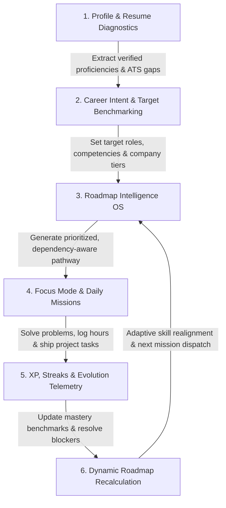
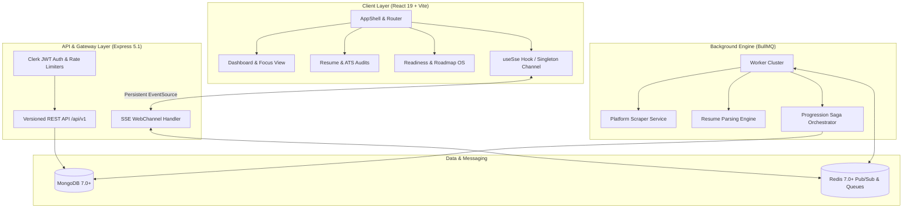

# DevTrack: Developer Productivity & Career Readiness OS

<div align="center">

> **Status:** **Beta Candidate** — Core platform domains are structurally complete, build-green, and actively validated.

[](https://www.typescriptlang.org/)
[](https://react.dev/)
[](https://expressjs.com/)
[](https://www.mongodb.com/)
[](https://redis.io/)
[](https://github.com/VarshithReddy2006/DevTrack/actions)
[](https://opensource.org/licenses/MIT)

<p align="center">
  <b>Turn raw software engineering activity into an adaptive, gamified career growth journey.</b><br />
  DevTrack connects competitive programming telemetry, GitHub contributions, project velocity, and ATS resume audits with real-time skill gap analysis and personalized roadmap intelligence.
</p>

[Features](#key-features) • [Growth Loop](#the-growth-loop-workflow) • [Architecture](#system-architecture) • [Tech Stack](#tech-stack) • [Quick Start](#quick-start--installation) • [Testing](#testing--verification) • [API Routes](#canonical-api-routes-apiv1) • [Acknowledgements](#acknowledgements) • [Contributing](#contributing)

</div>

---

### Mission Control & Telemetry Preview

```text
┌────────────────────────────────────────────────────────────────────────────────────────┐
│ DEVTRACK MISSION CONTROL & CAREER READINESS OS                                         │
├───────────────────────────────┬────────────────────────────────────────────────────────┤
│ DAILY MISSIONS                │ REAL-TIME TELEMETRY & EVOLUTION ENGINE                 │
│  [x] Graph BFS Traversal (LC) │  Level 7 Lead Engineer Track • 2,450 / 3,000 XP (81%)  │
│  [x] Distributed Cache Task   │  Streak: 18 Consecutive Days (Freeze: 1 active)        │
│  [ ] System Design Brief      │  Focus Time: 3h 45m logged today (Pomodoro: 4 cycles)  │
├───────────────────────────────┴────────────────────────────────────────────────────────┤
│ ATS RESUME INTELLIGENCE: Score 88/100 • 3 Verified Claims • 2 Skill Gaps Identified    │
│ ADAPTIVE ROADMAP: Real-time recalculation active — next milestone: Redis Pub/Sub       │
└────────────────────────────────────────────────────────────────────────────────────────┘
```

---

## Why DevTrack?

Developers spend hundreds of hours across disconnected silos: solving algorithm challenges on LeetCode and Codeforces, pushing repositories to GitHub, and drafting resumes in isolation. These activities rarely provide unified feedback on **how close a developer is to their dream engineering role**.

**DevTrack closes this loop.** It ingests coding telemetry, evaluates competencies against industry benchmarks, identifies high-priority gaps, and feeds them directly into daily focus blocks, ensuring that every hour invested translates into measurable career readiness.

---

## The Growth Loop Workflow

DevTrack operates as a closed-loop progression system:



1. **Intake & Diagnostics:** Import a PDF/DOCX resume or sync competitive platforms to establish an audited baseline.
2. **Gap Analysis:** The Readiness Engine compares verified proficiencies against target role requirements (e.g., Backend Lead, Systems Engineer).
3. **Personalized Roadmaps:** Skill gaps are sequenced into an actionable, dependency-aware milestone pathway.
4. **Active Focus Execution:** Developers tackle daily missions with persistent Pomodoro/stopwatch timers and milestone checklists.
5. **Telemetry & Rewards:** Activity triggers progression sagas that award XP, maintain consecutive streaks, and log verifiable proof.
6. **Adaptive Realignment:** Roadmaps automatically recalculate as skills are mastered, guiding the next focus block.

---

## Key Features

| Domain | Capabilities | Source Module |
|---|---|---|
| **DSA Intelligence & Tracking** | Multi-platform ingestion (LeetCode, Codeforces, CodeChef), daily challenge indexing, topic-level mastery heatmaps, contest trackers, and weekly analytics. | `backend/src/modules/dsa` |
| **Resume Intelligence OS** | Multi-format PDF/DOCX parsing, deterministic ATS compatibility auditing, GitHub claim validation, wording suggestions, and exportable report dossiers. | `backend/src/modules/resume` |
| **Career Readiness Engine** | Diagnostic benchmarks, role gap analysis, adaptive roadmap sequencing, evolution progression graphs, and AI-guided recommendations with fallback templates. | `backend/src/modules/readiness` |
| **Focus Mode & Mission Control** | Daily missions, persistent Pomodoro/stopwatch timers, active checklist cards, anti-distraction modes, and automated streak upkeep. | `backend/src/modules/focus` |
| **Gamification Engine** | XP accrual, non-linear level curves (1–10+), consecutive day streaks with freeze protection mechanics, milestone awards, and achievement badges. | `backend/src/modules/xp` & `streak` |
| **Project Workspace** | Full-stack project and task Kanban boards, sprint velocity metrics, and bidirectional GitHub repository linkages. | `backend/src/modules/projects` |
| **Real-time WebChannels** | Server-Sent Events (SSE) singleton channels backed by Redis pub/sub for real-time dashboard state updates and live toasts. | `backend/src/shared/sse` |
| **Operations & Observability** | BullMQ queue metrics, Dead Letter Queue (DLQ) inspection and replay, health probes, and beta observability telemetry. | `backend/src/modules/ops` |

---

## System Architecture

DevTrack is designed as a modular monorepo emphasizing high data integrity, transactional progression sagas, and connection safety.



### Architectural Tenets
* **Lean Database Reads:** High-frequency dashboard and readiness endpoints use Mongoose `.lean()` to bypass hydration overhead, cutting memory allocations by ~40%.
* **Singleton SSE WebChannel:** Browser clients enforce exactly one persistent `EventSource` connection per tab via a shared store, mitigating socket exhaustion.
* **Strict Redis Namespacing:** Distributed caches and locks use strict `devtrack:<module>:<identifier>` keys with deterministic TTLs.
* **Non-Blocking Ingestion:** Scrapers, PDF parsers, and AI embeddings execute inside BullMQ background queues, maintaining sub-100ms API response times.
* **Graceful Degradation:** When AI credentials (`OPENAI_API_KEY` or `GEMINI_API_KEY`) are omitted, intelligent deterministic fallback templates take over without crashing.

---

## Tech Stack

| Domain | Technologies | Details |
|---|---|---|
| **Frontend** | React 19, Vite 8, TypeScript 5.9 | Tailwind CSS 4, Framer Motion 12, Zustand 5, TanStack Query 5, Axios, Clerk React |
| **Backend** | Express 5.1, Node.js 20+, TypeScript 5.9 | Mongoose 8.14, BullMQ 5.76, ioredis 5.10, Zod 3.24, Helmet 8.1, Clerk Express |
| **Datastores** | MongoDB 7.0+, Redis 7.0+ | MongoDB for persistence; Redis for caching, pub/sub channels, and BullMQ queues |
| **AI & Document Parsing** | Google Gemini, OpenAI, PDF/DOCX Parsers | `@google/generative-ai`, `openai`, `pdf-parse`, `mammoth` |
| **Testing** | Vitest 4, Playwright 1.48 | Unit & integration test suites, end-to-end browser specs |
| **Orchestration & DevOps** | Docker Compose, Custom Dev-Orchestrator | Local multi-service runner (`dev-orchestrator`), Render (API/Workers), Vercel (SPA) |

---

## Repository Structure

```text
DevTrack/
├── .github/                      # CI/CD Workflows (pr-checks, deploy-production, deploy-staging)
├── dev-orchestrator/             # Local multi-service process manager & health monitor
│   └── src/                      # Child process manager, port cleaner, and health probes
├── backend/                      # Express 5 REST API & BullMQ Background Workers
│   ├── src/
│   │   ├── config/               # Environment schema validation (Zod) and constants
│   │   ├── db/models/            # 60+ Mongoose models (Readiness, Resume, XP, Projects)
│   │   ├── middleware/           # Clerk JWT auth, tiered rate limiters, error handling
│   │   ├── modules/              # Modular domain controllers, services, and routes
│   │   │   ├── auth/             # Clerk identity synchronization
│   │   │   ├── dsa/              # DSA problem trackers & LeetCode calendar parser
│   │   │   ├── focus/            # Mission control, pomodoro cycles, checklists
│   │   │   ├── readiness/        # Skill benchmarks, gap analysis, roadmap sequencing
│   │   │   ├── resume/           # ATS engine, extraction mappers, wording optimizer
│   │   │   ├── streak/           # Consecutive day streaks & freeze mechanics
│   │   │   └── xp/               # Gamification point rules and leveling sagas
│   │   ├── shared/               # Redis singletons, BullMQ worker cluster, SSE handler
│   │   ├── index.ts              # Express API server entrypoint
│   │   └── worker-entrypoint.ts  # Standalone worker cluster entrypoint
│   └── package.json
├── frontend/                     # React 19 Client SPA
│   ├── src/
│   │   ├── components/           # Reusable UI components, surface cards, modals
│   │   ├── features/             # Scoped domain modules (Readiness, Resume, Focus, DSA)
│   │   ├── pages/                # Route views (Dashboard, Focus, DSA, Projects, Readiness)
│   │   ├── services/             # Axios API clients & SSE connection listeners
│   │   ├── store/                # Zustand transient stores (UI, modals, session)
│   │   └── router/               # React Router configuration
│   └── package.json
├── docs/                         # Technical documentation & architectural blueprints
│   ├── architecture.md           # Topology, queue lifecycles, and SSE stream mechanics
│   ├── conventions.md            # Coding standards, database patterns, state rules
│   ├── ARCHITECTURE.md           # Extended system documentation
│   └── CONTRIBUTING.md           # Contribution guidelines & NWoC 2026 rules
├── docker-compose.yml            # Local development infrastructure (MongoDB + Redis)
├── docker-compose.prod.yml       # Production containerized deployment
├── package.json                  # Root workspace scripts
└── README.md
```

---

## Quick Start & Installation

### Prerequisites
* **Node.js:** `>= 18.0.0` (Node 22 LTS recommended)
* **npm:** `>= 9.0.0`
* **Docker Desktop:** For running local MongoDB and Redis instances
* **Clerk Account:** Free account at [clerk.com](https://clerk.com) for authentication credentials

---

### Step 1: Clone the Repository
```bash
git clone https://github.com/VarshithReddy2006/DevTrack.git
cd DevTrack
```

### Step 2: Install Monorepo Dependencies
```bash
npm run install-all
```
*This installs dependencies across the root, `backend/`, `frontend/`, and `dev-orchestrator/`.*

### Step 3: Environment Configuration
Copy the provided environment templates:

```bash
# macOS / Linux
cp backend/.env.example backend/.env
cp frontend/.env.example frontend/.env

# Windows PowerShell
Copy-Item backend/.env.example backend/.env
Copy-Item frontend/.env.example frontend/.env
```

Configure the essential keys:
* **`backend/.env`**:
  ```env
  PORT=3001
  NODE_ENV=development
  MONGODB_URI=mongodb://localhost:27017/devtrack
  REDIS_URL=redis://localhost:6379
  CLERK_SECRET_KEY=sk_test_... # From Clerk Dashboard → API Keys
  ```
* **`frontend/.env`**:
  ```env
  VITE_API_BASE_URL=http://localhost:3001/api/v1
  VITE_CLERK_PUBLISHABLE_KEY=pk_test_... # From Clerk Dashboard → API Keys
  ```

### Step 4: Start Infrastructure Containers
```bash
npm run dev:infra
```
*Launches MongoDB on port `27017` and Redis on port `6379` via Docker Compose.*

### Step 5: Launch DevTrack

Select the development mode suited to your workflow:

```bash
# Option A — Standard concurrent development (API + Frontend SPA)
npm run dev

# Option B — Full stack with BullMQ background workers and orchestrator health probes
npm run dev:all

# Option C — Complete containerized Docker Compose environment
docker compose up --build
```

### Local Access Points

| Service | Address | Description |
|---|---|---|
| **Frontend Application** | [http://localhost:5173](http://localhost:5173) | Interactive React 19 Client SPA |
| **Backend REST API** | [http://localhost:3001](http://localhost:3001) | Express 5.1 Canonical `/api/v1` Gateway |
| **API Health Probe** | [http://localhost:3001/health](http://localhost:3001/health) | System, datastore, and Redis ping status |

---

## Testing & Verification

DevTrack features an automated testing matrix covering unit math, integration sagas, and end-to-end user paths.

```bash
# ── Backend Test Suite ────────────────────────────────────────────────────────
# Run fast in-memory unit tests (140+ assertions across modules)
npm run test:unit --prefix backend

# Run database integration tests (requires MongoDB + Redis running)
npm run test:integration --prefix backend

# ── Frontend Test Suite ───────────────────────────────────────────────────────
# Run frontend unit tests (utilities, formatters, state mappers)
npm run test:unit --prefix frontend

# Run Playwright End-to-End browser tests (requires running application stack)
npm run test:e2e --prefix frontend
```

### Continuous Integration (CI)
GitHub Actions validates every pull request via `.github/workflows/pr-checks.yml`:
* **Static Verification:** Strict TypeScript compilation (`tsc --noEmit`) and ESLint checks.
* **Automated Unit Testing:** Vitest suites executed across backend and frontend workspaces.
* **Service Integration Tests:** Containerized MongoDB and Redis services booted with health probes.
* **Docker Verification:** Production container build verification for backend and frontend.

---

## Canonical API Routes (`/api/v1`)

All primary endpoints are versioned under `/api/v1` (legacy `/api/*` routes are preserved with deprecation headers):

| Module | Path Prefix | Auth Requirement | Description |
|---|---|---|---|
| **Auth** | `/auth` | Clerk JWT | Identity synchronization, handshake, and user onboarding |
| **Events** | `/events` | SSE Token | Server-Sent Events singleton telemetry stream |
| **Dashboard** | `/dashboard` | Required | Aggregated metrics, active missions, and activity heatmaps |
| **DSA** | `/dsa` | Required | Solved problem index, platform scrapers, and contest tracking |
| **Readiness** | `/readiness` | Required | Diagnostic benchmarks, role gap analysis, and roadmap trees |
| **Resume** | `/resume` | Required | Multi-format parsing, ATS scoring, and GitHub claim audit |
| **Focus** | `/focus` | Required | Stopwatch sessions, Pomodoro cycle tracking, and checklists |
| **Gamification** | `/xp`, `/streak`, `/missions` | Required | XP allocation sagas, streak updates with freeze mechanics |
| **Projects** | `/projects` | Required | Project and task CRUD operations, GitHub repository links |
| **Platforms** | `/platforms` | Required | Third-party platform synchronizers (LeetCode, Codeforces, GitHub) |
| **Ops (Admin)** | `/ops` | Auditor / Admin | Queue metrics, Dead Letter Queue (DLQ) inspection, and replays |

---

## Security & Performance Hardening

* **Tiered Rate Limiting:** High-sensitivity authentication and sync routes enforce strict windows (5 requests per 15 min), while dashboard reads allow higher throughput (`backend/src/middleware/rateLimitAdvanced.ts`).
* **Input Sanitization & Validation:** All requests pass Zod schema filters and injection mitigation before touching controllers (`backend/src/middleware/validation.ts`).
* **CORS & CSP Headers:** Strict HTTPS origin whitelisting in production combined with Helmet Content Security Policy and HSTS enforcement (`backend/src/index.ts`).
* **Abuse Mitigation Sagas:** Solve velocity and submission timestamps are audited to prevent spoofed XP or artificial streak progression (`backend/src/modules/xp/xp.service.ts`).

---

## AI Usability & Source of Truth

This repository is built to be self-explanatory to AI coding assistants (GitHub Copilot, Cursor, Codex, Antigravity) and human contributors alike.

### Mandatory Reading Order for AI Agents
1. **`README.md`** *(This file — platform vision, stack, directory structure, quickstart)*
2. **`AGENTS.md`** *(Single source of truth guidelines and agent routing)*
3. **`.Codex/proxima-routing.md`** *(AI orchestration framework and dispatch rules)*
4. **`docs/architecture.md`** *(System topology, saga lifecycles, and SSE mechanics)*
5. **`docs/conventions.md`** *(Coding standards, database patterns, and state rules)*

---


## Contributing

We welcome contributions from the community!

1. Please read **[CONTRIBUTING.md](./CONTRIBUTING.md)** before opening issues or submitting pull requests.
2. **Nexus Winter of Code (NWoC) 2026:** Ensure issues and PRs follow the mandatory labelling conventions (`nsoc26`, `level1`, `level2`, `level3`).
3. Always verify local typechecking and unit test suites before creating a pull request:
   ```bash
   npm run build --prefix backend
   npm run build --prefix frontend
   npm run test:unit --prefix backend
   npm run test:unit --prefix frontend
   ```

---

## License & Status

* **Status:** **Beta Candidate** — Software is actively undergoing testing, verification, and hardening.
* **License:** Released under the **[MIT License](https://opensource.org/licenses/MIT)**.
